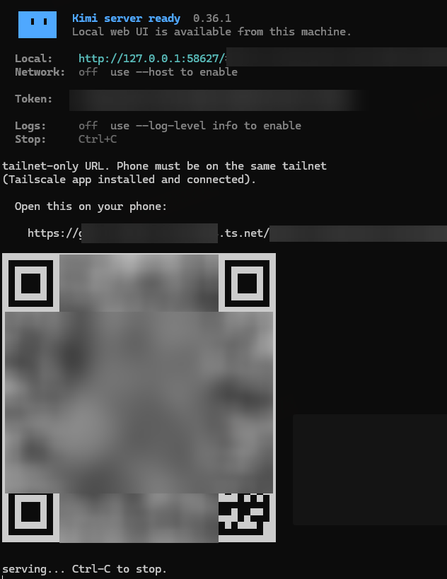

# kimi-remote

- One-click mobile web UI for [kimi code](https://www.kimi.com/code/docs/en/).
- Starts `kimi web`, exposes it through an encrypted tunnel, and prints a
    mobile-ready URL plus a QR code - the URL carries **no credential**.
    A memorable password you choose unlocks it on the phone.



## Quick start (Windows)

* Just click setup.ps1 once following the prompt to install your environment 

    - `setup.ps1` asks which tunnel you want (Tailscale / Cloudflare / both),
    - you through the one-time `tailscale up` login. 
    - installs the CLIs and [uv](https://docs.astral.sh/uv/) via winget, and walks

* Click `start.ps1` 

    * it will launcher with `uv run` (which also provides the `qrcode` package for the QR).
    * it asks for a login password on first run - or set `KIMI_REMOTE_PASSWORD`
      once (user env var) and it never asks again.

* If you want to manually run:

    ```powershell
    powershell -ExecutionPolicy Bypass -File .\setup.ps1   # one-time: installs uv + tunnel CLIs
    powershell -ExecutionPolicy Bypass -File .\start.ps1   # pick a tunnel, starts everything
    ```

- Use your phone to scan the qr code(or copy the link to your phone via email or what ever you can), paste to your web browser, **type your password**, enjoy the GUI
    - TailScale on mobile may be killed by the system constantly , **please activate tailscale manually when the connection seems failed**

## Usage (manual)

```sh
uv run kimi_remote.py              # tailscale serve (default, recommended)
uv run kimi_remote.py --cloudflare # cloudflare quick tunnel (public URL)
uv run kimi_remote.py --port 58627 # custom port
uv run kimi_remote.py --self-test  # exercise the auth gate, no tunnel needed
```

Plain `python kimi_remote.py` also works - stdlib only, QR optional.

Ctrl-C stops everything and tears down the tunnel.

## Tailscale mode (default)

- One-time setup: run `tailscale up` and log in via the browser.
- On the phone: install the Tailscale app and connect to the same tailnet.
- The URL is `https://<machine>.<tailnet>.ts.net/` - tailnet-only, HTTPS
  with a real certificate, never public. The page asks for your password.

## Cloudflare mode (`--cloudflare`)

No account or phone app needed. `cloudflared` gives a random public
`*.trycloudflare.com` URL. **The URL is public** - the password gate is the
only thing between it and your shell, so pick a real password and don't
share the URL. The QR/URL itself contains no secret.

One quirk:

- cloudflared prints the URL before Cloudflare's edge can serve it (seen:
  up to ~60s). The launcher probes the URL and only shows the QR once the
  edge answers, so the phone connects on the first try.

## How it works

- Picks verified-free ports itself (kimi web would silently bump a busy
  port, which would break the tunnel mapping).
- Asks for a password once (`KIMI_REMOTE_PASSWORD` env var, or a startup
  prompt with confirmation) and starts a loopback auth gate in front of
  kimi web. The tunnel points at the gate, kimi web stays on 127.0.0.1.
- The gate shows a password form; a correct password sets an `HttpOnly`
  cookie and redirects to `/#token=<token>`, so the web UI
  auto-authenticates exactly as before. After that the gate relays raw
  bytes (WebSocket-safe). Without the cookie, nothing reaches kimi web -
  not even a valid bearer token.
- Reads the bearer token from `~/.kimi-code/server.token` (creates it with
  `kimi web rotate-token` if missing).
- Starts `kimi web --no-open --port P --allowed-host <tunnel-host>` and
  the tunnel **in parallel**, for a faster link:
  - Tailscale: `tailscale serve --bg --https=443 http://127.0.0.1:G`
    (removed on exit); hostname is known upfront from
    `tailscale status --json`.
  - Cloudflare: parses the quick-tunnel URL from `cloudflared`'s stderr;
    `--allowed-host .trycloudflare.com` (leading dot = suffix match)
    covers whatever random hostname comes back.
- Probes the public URL and only prints the QR once the tunnel edge
  actually answers (cloudflared prints the URL up to ~60s early).

## Requirements

- `kimi` (kimi code CLI), `tailscale` and/or `cloudflared` on PATH
- Python 3.10+ stdlib only; optional `qrcode` package for the QR code

## Security

- The printed URL and QR carry **no credential** - safe to show on screen.
- The gate password comes from `KIMI_REMOTE_PASSWORD` or a startup prompt
  and is never printed or stored by this tool.
- kimi web's bearer-token auth stays on behind the gate; the token only
  crosses the tunnel after a correct password, as a client-side URL
  fragment (`#token=...`) that tunnel servers never see.
- Never pass `--dangerous-bypass-auth` to kimi web.
