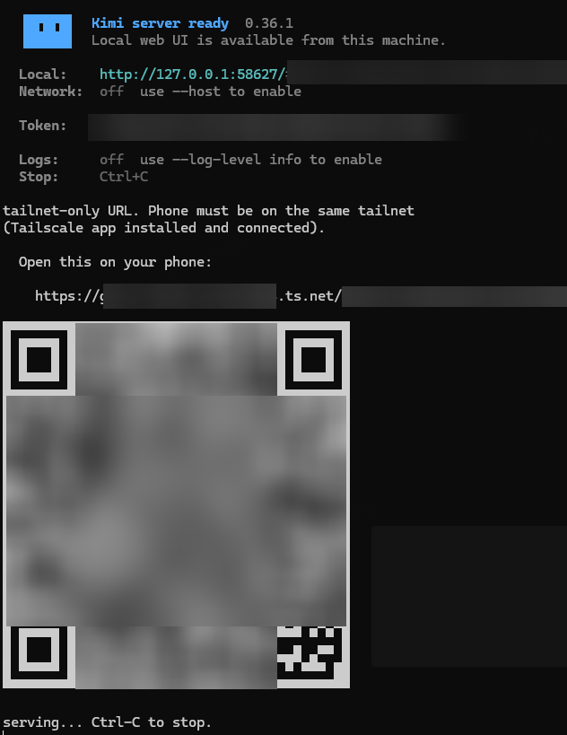

# kimi-remote

- One-click mobile web UI for [kimi code](https://www.kimi.com/code/docs/en/).
- Starts `kimi web`, exposes it through an encrypted tunnel, and prints a
    mobile-ready URL (bearer token embedded) plus a QR code — scan with your
    phone and you're in the conversation.



## Quick start (Windows)

```powershell
powershell -ExecutionPolicy Bypass -File .\setup.ps1   # one-time: installs uv + tunnel CLIs
powershell -ExecutionPolicy Bypass -File .\start.ps1   # pick a tunnel, starts everything
```

- `setup.ps1` asks which tunnel you want (Tailscale / Cloudflare / both),
- installs the CLIs and [uv](https://docs.astral.sh/uv/) via winget, and walks
- you through the one-time `tailscale up` login. `start.ps1` then runs the
    - it will launcher with `uv run` (which also provides the `qrcode` package for the QR).
- Use your phone to scan the qr code(or copy the link to your phone via email or what ever you can), paste to your web browser, enjoy the GUI
    - TailScale on mobile may be killed by the system constantly , **please activate tailscale manually when the connection seems failed**

## Usage (manual)

```sh
uv run kimi_remote.py              # tailscale serve (default, recommended)
uv run kimi_remote.py --cloudflare # cloudflare quick tunnel (public URL)
uv run kimi_remote.py --port 58627 # custom port
```

Plain `python kimi_remote.py` also works — stdlib only, QR optional.

Ctrl-C stops everything and tears down the tunnel.

## Tailscale mode (default)

- One-time setup: run `tailscale up` and log in via the browser.
- On the phone: install the Tailscale app and connect to the same tailnet.
- The URL is `https://<machine>.<tailnet>.ts.net/#token=<token>` —
  tailnet-only, HTTPS with a real certificate, never public.

## Cloudflare mode (`--cloudflare`)

No account or phone app needed. `cloudflared` gives a random public
`*.trycloudflare.com` URL. **The URL is public** — the kimi bearer token is
the only authentication, so treat the full URL as a secret and don't share
it. The QR/URL contains the token.

Two quirks:

- cloudflared prints the URL before Cloudflare's edge can serve it (seen:
  up to ~60s). The launcher probes the URL and only shows the QR once the
  edge answers, so the phone connects on the first try.
- Some QR scanners (Chrome's built-in one) strip the `#token=...`
  fragment. If the scanned link misses it, the token is also printed
  separately — paste it into the web UI's login field.

## How it works

- Reads the bearer token from `~/.kimi-code/server.token` (creates it with
  `kimi web rotate-token` if missing).
- Launches `kimi web --no-open --port P --allowed-host <tunnel-host>` —
  `--allowed-host` is required because kimi's DNS-rebinding check rejects
  non-localhost Host headers.
- Tailscale: `tailscale serve --bg --https=443 http://127.0.0.1:P`
  (removed on exit). Cloudflare: parses the quick-tunnel URL from
  `cloudflared`'s stderr before starting kimi, so the host is known.

## Requirements

- `kimi` (kimi code CLI), `tailscale` and/or `cloudflared` on PATH
- Python 3.10+ stdlib only; optional `qrcode` package for the QR code

## Security

Never pass `--dangerous-bypass-auth` to kimi web. The token in the URL
fragment (`#token=...`) is client-side only and is not sent to the tunnel
servers.
